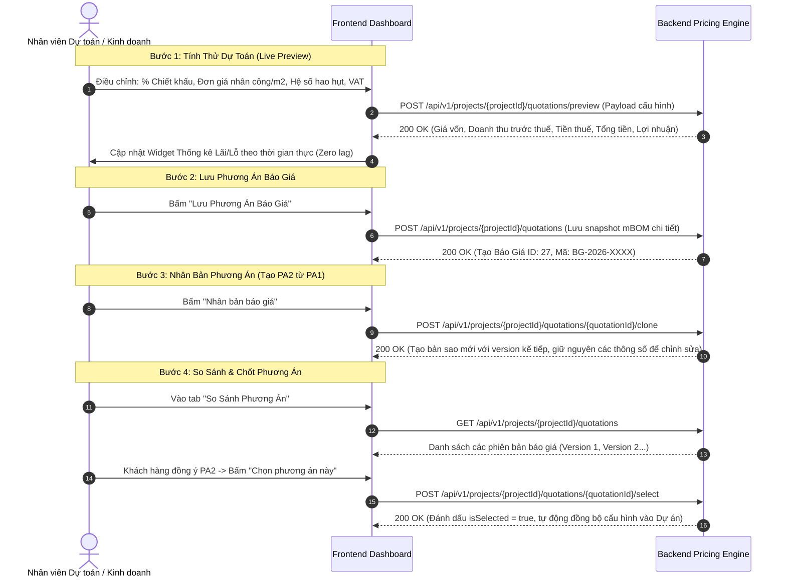

# HƯỚNG DẪN TÍCH HỢP FRONTEND: BÁO GIÁ & PRICING ENGINE (MODULE 003)

Module này cung cấp công cụ tính giá tự động (**Pricing Engine**), cho phép tạo nhiều phương án báo giá (Phương án 1 - Tiêu chuẩn, Phương án 2 - Cao cấp) để chủ đầu tư so sánh, nhân bản báo giá (`clone`), đóng băng bản bóc tách vật tư (**mBOM Snapshot**) và chốt phương án chính thức làm căn cứ ký hợp đồng.

---

## 1. Luồng Thao Tác Của Người Dùng Trên Frontend (UX Flow)



---

## 2. Công Thức Giá (Bottom-Up Pricing Engine)

Với mỗi bộ cửa (vị trí):

- `A` = `materialCost`: chi phí vật tư thuần từ BOM.
- `B` = `laborCost`: nhân công (sản xuất + lắp đặt + vệ sinh) theo `laborCalcUnit`.
- `C` = `aluminumWasteCost`: chi phí hao hụt nhôm.
- `E` = `1 + managementRatePercent / 100` (mặc định 16% -> x1.16).
- Giá vốn bộ (`costPrice`) = `round((A + B + C) * E)`.
- Giá gợi ý (`suggestedPrice`):
  - `pricingMode = markup`: giá vốn * (1 + `markupPercent` / 100).
  - `pricingMode = margin`: giá vốn / (1 - `marginPercent` / 100).
- `sellingPrice`: giá bán thực tế, có thể sửa tay qua `customSellingPrices`.

Tổng hợp: `workshopPrice` (giá xưởng) + `otherCost` (D) -> `subtotalSellingPrice` -> trừ `discountAmount` -> `totalAmountBeforeVat` -> cộng `vatAmount` -> `totalAmount`.

---

## 3. Chi Tiết Các API Call & Chuẩn Dữ Liệu

> Quy ước: JSON trả về dạng **camelCase**. Mọi số tiền là số nguyên VND.
> Types tương ứng nằm tại `src/types/quotation.ts`, server actions tại `src/actions/project/index.ts`.

### 3.1. Tính Dự Toán Nháp (Preview Pricing Engine)
- **Endpoint:** `POST /api/v1/projects/{projectId}/quotations/preview`
- **Action:** `previewProjectQuotation(projectId, data)`
- **Tác dụng:** Chạy Pricing Engine, không lưu Database, phục vụ giao diện kéo trượt slider / đổi cấu hình trực tiếp.
- **Request Body** (`ProjectQuotationPreviewRequest`, tất cả có giá trị mặc định):

| Field | Kiểu | Mặc định | Ý nghĩa |
|---|---|---|---|
| `scopeType` | `all` \| `by_floor` | `all` | Phạm vi tính giá |
| `floorIds` | `number[]` | null | Bắt buộc khi `by_floor` |
| `laborCalcUnit` | `vnd_per_m2` \| `vnd_per_kg` | `vnd_per_m2` | Cơ chế tính nhân công |
| `laborProductionRate` | number | 150000 | Đơn giá nhân công sản xuất |
| `laborInstallRate` | number | 120000 | Đơn giá nhân công lắp đặt |
| `laborCleanRate` | number | 30000 | Đơn giá nhân công vệ sinh |
| `otherCost` | number | 0 | D: chi phí khác (xe cẩu, vận chuyển...) |
| `otherSellingPrice` | number | = `otherCost` | Giá bán dòng chi phí khác |
| `managementRatePercent` | number | 16.0 | E: % chi phí quản lý xưởng |
| `pricingMode` | `markup` \| `margin` | `markup` | Cơ chế giá gợi ý |
| `markupPercent` | number | 45.0 | Lãi trên vốn (mode markup) |
| `marginPercent` | number (<100) | 30.0 | Biên lãi gộp (mode margin) |
| `discountPercent` | number (0-100) | 0.0 | Chiết khấu đàm phán |
| `vatPercent` | number (0-100) | 10.0 | Thuế GTGT |
| `accessoryMode` | `combined` \| `separated` | `combined` | Chế độ phụ kiện |
| `customSellingPrices` | `{ [positionId]: price }` | null | Giá bán sửa tay từng vị trí |

  ```json
  {
    "scopeType": "all",
    "laborCalcUnit": "vnd_per_m2",
    "laborProductionRate": 150000,
    "laborInstallRate": 120000,
    "laborCleanRate": 30000,
    "otherCost": 1500000,
    "managementRatePercent": 16.0,
    "pricingMode": "markup",
    "markupPercent": 45.0,
    "discountPercent": 5.0,
    "vatPercent": 10.0,
    "accessoryMode": "combined",
    "customSellingPrices": { "101": 22000000 }
  }
  ```

- **Response Body (200 OK)** (`ProjectQuotationPreviewResponse`):
  ```json
  {
    "items": [
      {
        "positionId": 101,
        "positionCode": "D1-01",
        "positionName": "Cửa đi chính",
        "doorName": "Cửa đi chính 4 cánh",
        "doorType": "door",
        "floorId": 3,
        "floorName": "Tầng 1",
        "width": 2400,
        "height": 2200,
        "areaM2": 5.28,
        "aluminumKg": 52.4,
        "materialCost": 9800000,
        "laborCost": 1584000,
        "aluminumWasteCost": 320000,
        "costPrice": 13035000,
        "suggestedPrice": 18900000,
        "sellingPrice": 22000000,
        "isManuallyEdited": true,
        "isBelowCost": false
      }
    ],
    "totalPositions": 12,
    "totalAreaM2": 11.312,
    "totalAluminumKg": 134.4,
    "materialCost": 25000000,
    "laborCost": 3394000,
    "aluminumWasteCost": 800000,
    "otherCost": 1500000,
    "otherSellingPrice": 1500000,
    "workshopPrice": 33603504,
    "subtotalSellingPrice": 44138000,
    "discountAmount": 2206900,
    "totalAmountBeforeVat": 41931100,
    "totalProfit": 8327596,
    "effectiveMarginPercent": 19.86,
    "vatAmount": 4193110,
    "totalAmount": 46124210,
    "warningFlags": [],
    "isLoss": false
  }
  ```
  - `isLoss = true` hoặc `items[].isBelowCost = true` -> FE hiển thị cảnh báo bán lỗ / bán dưới giá vốn.
  - `warningFlags`: danh sách cảnh báo an toàn biên lãi và giá bán.

---

### 3.2. Lưu Phương Án Báo Giá Chính Thức (Save Quotation)
- **Endpoint:** `POST /api/v1/projects/{projectId}/quotations`
- **Action:** `createProjectQuotationOfficial(projectId, data)`
- **Tác dụng:** Đóng băng toàn bộ giá thành và danh mục vật tư thành snapshot (`snapshotItems`), cấp mã tự động `BG-YYYY-XXXX`.
- **Request Body** (`ProjectQuotationCreatePayload`): toàn bộ field của mục 3.1 cộng thêm:

| Field | Kiểu | Ghi chú |
|---|---|---|
| `projectId` | number | **Bắt buộc** (theo schema API) |
| `name` | string (<=150) | **Bắt buộc**, tên phương án |
| `kind` | `main` \| `change_order` | Mặc định `main` |
| `note` | string | Ghi chú điều khoản, bảo hành |

  ```json
  {
    "projectId": 58,
    "name": "Phương án 1 - Xingfa Class A Anodize",
    "kind": "main",
    "discountPercent": 5.0,
    "vatPercent": 10.0,
    "laborCalcUnit": "vnd_per_m2",
    "otherCost": 1500000,
    "note": "Báo giá có hiệu lực trong vòng 15 ngày"
  }
  ```

- **Response Body (200 OK)** (`ProjectQuotationItem`):
  ```json
  {
    "id": 27,
    "projectId": 58,
    "code": "BG-2026-0012",
    "name": "Phương án 1 - Xingfa Class A Anodize",
    "version": 1,
    "status": "draft",
    "kind": "main",
    "isSelected": false,
    "isLocked": false,
    "scopeType": "all",
    "laborCalcUnit": "vnd_per_m2",
    "laborProductionRate": 150000,
    "laborInstallRate": 120000,
    "laborCleanRate": 30000,
    "materialCost": 25000000,
    "laborCost": 3394000,
    "aluminumWasteCost": 800000,
    "otherCost": 1500000,
    "otherSellingPrice": 1500000,
    "managementRatePercent": 16.0,
    "pricingMode": "markup",
    "markupPercent": 45.0,
    "marginPercent": 30.0,
    "accessoryMode": "combined",
    "workshopPrice": 33603504,
    "subtotalSellingPrice": 44138000,
    "discountPercent": 5.0,
    "discountAmount": 2206900,
    "totalAmountBeforeVat": 41931100,
    "vatPercent": 10.0,
    "vatAmount": 4193110,
    "totalAmount": 46124210,
    "totalProfit": 8327596,
    "effectiveMarginPercent": 19.86,
    "snapshotItems": [],
    "note": "Báo giá có hiệu lực trong vòng 15 ngày",
    "createdAt": "2026-10-14T09:00:00",
    "updatedAt": "2026-10-14T09:00:00"
  }
  ```
  - `snapshotItems` có cấu trúc giống `items` ở mục 3.1 (`QuotationDoorItemSnapshot`).

---

### 3.3. Lấy Danh Sách & Chi Tiết Báo Giá
- **Danh sách:** `GET /api/v1/projects/{projectId}/quotations` -> action `getProjectQuotations(projectId, params)`
  - Query (`ProjectQuotationQueryParams`): `status`, `kind`, `isSelected`, `code`, `offset`, `limit`.
  - Response: `{ items: ProjectQuotationItem[], meta: { total, offset, limit, next } }`.
- **Chi tiết:** `GET /api/v1/projects/{projectId}/quotations/{quotationId}` -> action `getProjectQuotation` -> `ProjectQuotationDetail` (= `ProjectQuotationItem` + `quotationFloors`).
- **Cập nhật:** `PUT /api/v1/projects/{projectId}/quotations/{quotationId}` -> action `updateProjectQuotation`
  - Body (`ProjectQuotationUpdatePayload`): mọi field đều tùy chọn (`name`, `note` và các field cấu hình ở mục 3.1).
  - Nếu báo giá đã bị khóa `isLocked = true` do hợp đồng đã ký kết, Backend chặn sửa và trả mã lỗi 403 Forbidden.
- **Xóa:** `DELETE /api/v1/projects/{projectId}/quotations/{quotationId}` -> action `deleteProjectQuotation`
  - Chỉ xóa được khi chưa khóa (`isLocked = false`) và chưa chọn chính thức (`isSelected = false`).

---

### 3.4. Nhân Bản Báo Giá (Clone Quotation)
- **Endpoint:** `POST /api/v1/projects/{projectId}/quotations/{quotationId}/clone`
- **Action:** `cloneProjectQuotation(projectId, quotationId, newName?)`
- **Request Body** (`ProjectQuotationClonePayload`):
  ```json
  { "newName": "Phương án 2 - Cao cấp" }
  ```
- **Tác dụng:** Copy toàn bộ dữ liệu báo giá nguồn sang báo giá mới với tên `newName`, tăng chỉ số phiên bản (`version`), để nhân viên kinh doanh nhanh chóng điều chỉnh hệ số và chào giá khách hàng.
- **Response:** `ProjectQuotationItem`.

---

### 3.5. Chọn Phương Án Chính Thức (Select Official Quotation)
- **Endpoint:** `POST /api/v1/projects/{projectId}/quotations/{quotationId}/select`
- **Action:** `selectProjectQuotation(projectId, quotationId)`
- **Tác dụng:** Khi khách hàng đồng ý chốt phương án nào, nhấn chọn phương án đó. Backend sẽ:
  1. Chuyển `isSelected = true` cho báo giá được chọn.
  2. Tự động chuyển tất cả các báo giá khác của dự án về `isSelected = false`.
  3. Cập nhật trạng thái dự án sang `quotation` hoặc sẵn sàng chuyển sang ký Hợp đồng (`contract`).
- **Response:** `ProjectQuotationItem`.

---

## 4. Bảng Ánh Xạ Từ Điển (Dictionary Mapping) Cho Frontend

```typescript
export const QUOTATION_STATUS_MAP: Record<string, { label: string; color: string }> = {
  draft:     { label: 'Bản thảo',     color: 'default' },
  sent:      { label: 'Đã gửi khách', color: 'blue' },
  accepted:  { label: 'Đã chốt',      color: 'success' },
  rejected:  { label: 'Từ chối',      color: 'error' }
};

export const QUOTATION_KIND_MAP: Record<string, string> = {
  main:          'Báo giá chính',
  change_order:  'Phát sinh'
};

export const LABOR_CALC_UNIT_MAP: Record<string, string> = {
  vnd_per_m2:    'VNĐ / m²',
  vnd_per_kg:    'VNĐ / kg'
};

export const PRICING_MODE_MAP: Record<string, string> = {
  markup: 'Lãi trên vốn (Markup)',
  margin: 'Biên lãi gộp (Margin)'
};

export const ACCESSORY_MODE_MAP: Record<string, string> = {
  combined:  'Gộp trong giá bộ cửa',
  separated: 'Tách riêng phụ kiện'
};
```
